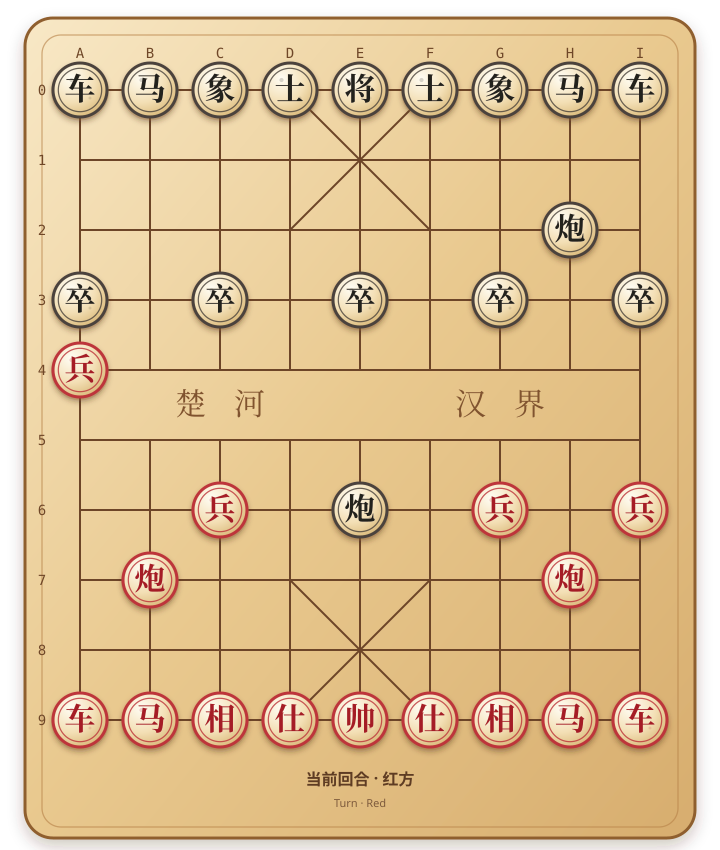

# ♟️ 中国象棋
<i>Chinese Chess · Xiangqi</i>

在 GitHub 上和访客一起下一盘中国象棋。每一步由 Issue 提交，由 Actions 自动判定棋规并更新共享棋局。  
<i>Play a shared game of Xiangqi with GitHub visitors. Every move is submitted through an Issue and validated automatically by GitHub Actions.</i>

---

<!-- XIANGQI:START -->

### 当前回合：🔴 红方　·　已走 4 手
<i>Turn: Red · 4 ply played.</i>

### 🎯 选择下一步
<i>Choose the next move</i>

点击任一目标坐标，会打开一个已经填好走法的 GitHub Issue；提交后，Actions 会自动验证棋规并刷新棋盘。
 <i>Click any destination to open a pre-filled GitHub Issue. After submission, Actions validates the move and refreshes the shared board automatically.</i>

| 棋子 / 起点 Piece / From | 可选目标位置 Legal destinations |
|:---:|:---|
| **兵 a4** Pawn | [a3](https://github.com/Lin-SX/Lin-SX/issues/new?title=Xiangqi%20move%3A%20a4-a3&body=xiangqi%3A%20a4-a3) · [b4](https://github.com/Lin-SX/Lin-SX/issues/new?title=Xiangqi%20move%3A%20a4-b4&body=xiangqi%3A%20a4-b4) |
| **兵 c6** Pawn | [c5](https://github.com/Lin-SX/Lin-SX/issues/new?title=Xiangqi%20move%3A%20c6-c5&body=xiangqi%3A%20c6-c5) |
| **兵 g6** Pawn | [g5](https://github.com/Lin-SX/Lin-SX/issues/new?title=Xiangqi%20move%3A%20g6-g5&body=xiangqi%3A%20g6-g5) |
| **兵 i6** Pawn | [i5](https://github.com/Lin-SX/Lin-SX/issues/new?title=Xiangqi%20move%3A%20i6-i5&body=xiangqi%3A%20i6-i5) |
| **炮 b7** Cannon | [c7](https://github.com/Lin-SX/Lin-SX/issues/new?title=Xiangqi%20move%3A%20b7-c7&body=xiangqi%3A%20b7-c7) · [d7](https://github.com/Lin-SX/Lin-SX/issues/new?title=Xiangqi%20move%3A%20b7-d7&body=xiangqi%3A%20b7-d7) · [f7](https://github.com/Lin-SX/Lin-SX/issues/new?title=Xiangqi%20move%3A%20b7-f7&body=xiangqi%3A%20b7-f7) · [g7](https://github.com/Lin-SX/Lin-SX/issues/new?title=Xiangqi%20move%3A%20b7-g7&body=xiangqi%3A%20b7-g7) · [a7](https://github.com/Lin-SX/Lin-SX/issues/new?title=Xiangqi%20move%3A%20b7-a7&body=xiangqi%3A%20b7-a7) · [b8](https://github.com/Lin-SX/Lin-SX/issues/new?title=Xiangqi%20move%3A%20b7-b8&body=xiangqi%3A%20b7-b8) · [b6](https://github.com/Lin-SX/Lin-SX/issues/new?title=Xiangqi%20move%3A%20b7-b6&body=xiangqi%3A%20b7-b6) · [b5](https://github.com/Lin-SX/Lin-SX/issues/new?title=Xiangqi%20move%3A%20b7-b5&body=xiangqi%3A%20b7-b5) · [b4](https://github.com/Lin-SX/Lin-SX/issues/new?title=Xiangqi%20move%3A%20b7-b4&body=xiangqi%3A%20b7-b4) · [b3](https://github.com/Lin-SX/Lin-SX/issues/new?title=Xiangqi%20move%3A%20b7-b3&body=xiangqi%3A%20b7-b3) · [b2](https://github.com/Lin-SX/Lin-SX/issues/new?title=Xiangqi%20move%3A%20b7-b2&body=xiangqi%3A%20b7-b2) · [b1](https://github.com/Lin-SX/Lin-SX/issues/new?title=Xiangqi%20move%3A%20b7-b1&body=xiangqi%3A%20b7-b1) |
| **炮 h7** Cannon | [i7](https://github.com/Lin-SX/Lin-SX/issues/new?title=Xiangqi%20move%3A%20h7-i7&body=xiangqi%3A%20h7-i7) · [g7](https://github.com/Lin-SX/Lin-SX/issues/new?title=Xiangqi%20move%3A%20h7-g7&body=xiangqi%3A%20h7-g7) · [f7](https://github.com/Lin-SX/Lin-SX/issues/new?title=Xiangqi%20move%3A%20h7-f7&body=xiangqi%3A%20h7-f7) · [d7](https://github.com/Lin-SX/Lin-SX/issues/new?title=Xiangqi%20move%3A%20h7-d7&body=xiangqi%3A%20h7-d7) · [c7](https://github.com/Lin-SX/Lin-SX/issues/new?title=Xiangqi%20move%3A%20h7-c7&body=xiangqi%3A%20h7-c7) · [h8](https://github.com/Lin-SX/Lin-SX/issues/new?title=Xiangqi%20move%3A%20h7-h8&body=xiangqi%3A%20h7-h8) · [h6](https://github.com/Lin-SX/Lin-SX/issues/new?title=Xiangqi%20move%3A%20h7-h6&body=xiangqi%3A%20h7-h6) · [h5](https://github.com/Lin-SX/Lin-SX/issues/new?title=Xiangqi%20move%3A%20h7-h5&body=xiangqi%3A%20h7-h5) · [h4](https://github.com/Lin-SX/Lin-SX/issues/new?title=Xiangqi%20move%3A%20h7-h4&body=xiangqi%3A%20h7-h4) · [h3](https://github.com/Lin-SX/Lin-SX/issues/new?title=Xiangqi%20move%3A%20h7-h3&body=xiangqi%3A%20h7-h3) · [h0](https://github.com/Lin-SX/Lin-SX/issues/new?title=Xiangqi%20move%3A%20h7-h0&body=xiangqi%3A%20h7-h0) |
| **车 a9** Rook | [a8](https://github.com/Lin-SX/Lin-SX/issues/new?title=Xiangqi%20move%3A%20a9-a8&body=xiangqi%3A%20a9-a8) · [a7](https://github.com/Lin-SX/Lin-SX/issues/new?title=Xiangqi%20move%3A%20a9-a7&body=xiangqi%3A%20a9-a7) · [a6](https://github.com/Lin-SX/Lin-SX/issues/new?title=Xiangqi%20move%3A%20a9-a6&body=xiangqi%3A%20a9-a6) · [a5](https://github.com/Lin-SX/Lin-SX/issues/new?title=Xiangqi%20move%3A%20a9-a5&body=xiangqi%3A%20a9-a5) |
| **马 b9** Horse | [c7](https://github.com/Lin-SX/Lin-SX/issues/new?title=Xiangqi%20move%3A%20b9-c7&body=xiangqi%3A%20b9-c7) · [a7](https://github.com/Lin-SX/Lin-SX/issues/new?title=Xiangqi%20move%3A%20b9-a7&body=xiangqi%3A%20b9-a7) |
| **相 c9** Elephant | [a7](https://github.com/Lin-SX/Lin-SX/issues/new?title=Xiangqi%20move%3A%20c9-a7&body=xiangqi%3A%20c9-a7) |
| **帅 e9** General | [e8](https://github.com/Lin-SX/Lin-SX/issues/new?title=Xiangqi%20move%3A%20e9-e8&body=xiangqi%3A%20e9-e8) |
| **相 g9** Elephant | [i7](https://github.com/Lin-SX/Lin-SX/issues/new?title=Xiangqi%20move%3A%20g9-i7&body=xiangqi%3A%20g9-i7) |
| **马 h9** Horse | [i7](https://github.com/Lin-SX/Lin-SX/issues/new?title=Xiangqi%20move%3A%20h9-i7&body=xiangqi%3A%20h9-i7) · [g7](https://github.com/Lin-SX/Lin-SX/issues/new?title=Xiangqi%20move%3A%20h9-g7&body=xiangqi%3A%20h9-g7) |
| **车 i9** Rook | [i8](https://github.com/Lin-SX/Lin-SX/issues/new?title=Xiangqi%20move%3A%20i9-i8&body=xiangqi%3A%20i9-i8) · [i7](https://github.com/Lin-SX/Lin-SX/issues/new?title=Xiangqi%20move%3A%20i9-i7&body=xiangqi%3A%20i9-i7) |

📜 最近 5 步

<i>Last five moves in this game</i>

- **黑方** · e2 → e6 · @Shengxiang-Lin <i>Black · e2 → e6 · @Shengxiang-Lin</i>
- **红方** · a5 → a4 · @Lin-SX <i>Red · a5 → a4 · @Lin-SX</i>
- **黑方** · b2 → e2 · @Shengxiang-Lin <i>Black · b2 → e2 · @Shengxiang-Lin</i>
- **红方** · a6 → a5 · 历史棋步 <i>Red · a6 → a5 · recorded move</i>

🏆 最活跃玩家 Top 10

<i>Top 10 most active players</i>

| 排名 Rank | 玩家 Player | 有效走棋 Moves |
|:---:|:---|---:|
| 1 | [@Shengxiang-Lin](https://github.com/Shengxiang-Lin) | 2 |
| 2 | [@Lin-SX](https://github.com/Lin-SX) | 1 |

### ⚙️ 工作原理
<i>How it works</i>

1. **选择走法：** 点击棋盘下方的目标坐标，创建预填好的 GitHub Issue。 <i>Choose a move: click a destination below the board to create a pre-filled GitHub Issue.</i>
2. **自动判定：** GitHub Actions 运行 Python 象棋规则引擎，验证走法、将军与自陷将军等约束。 <i>Validate automatically: GitHub Actions runs the Python Xiangqi engine and checks move legality, check, and self-check.</i>
3. **更新棋局：** 合法走法写入共享状态，并自动刷新棋盘、最近走棋与玩家统计。 <i>Update the game: legal moves are committed to the shared state and the board, history, and player stats are regenerated.</i>

发现问题或有改进建议？欢迎 [提交 Issue](https://github.com/Lin-SX/Lin-SX/issues/new)。
 <i>Found a bug or have an idea? Feel free to [open an issue](https://github.com/Lin-SX/Lin-SX/issues/new).</i>
<!-- XIANGQI:END -->

---

[GitHub](https://github.com/Lin-SX) · Made with ♟️

