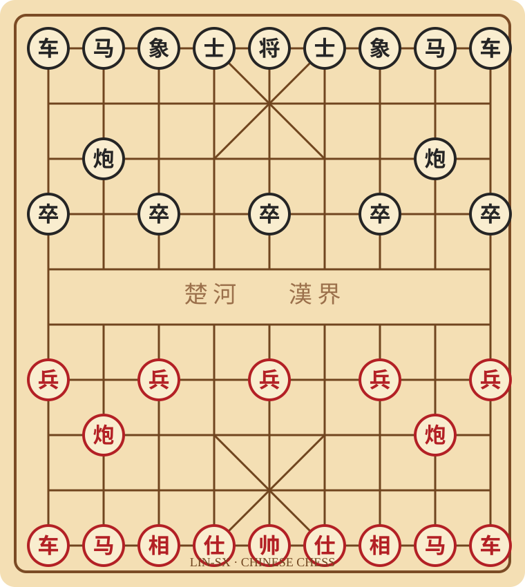

# Hi, I'm Lin-SX 👋

Welcome to my GitHub profile.

## ♟️ Chinese Chess · 中国象棋

欢迎来我的 GitHub 主页下一盘中国象棋！这是一个由 GitHub Issues 和 Actions 驱动的共享棋局。

<!-- XIANGQI:START -->

**当前回合：红方** · 已走 0 手 · 合法走法 44 种

### 下一步怎么走？
和 marcizhu 的国际象棋示例一样，下面直接列出当前所有合法走法。**点击「目标位置」就会跳转到预填好棋步的 GitHub Issue 页面**；你只需提交 Issue，不用手动填写内容。

| 棋子 / 起点 | 可选目标位置（点击即可提交） |
|:---:|:---|
| **兵 a6** | [a5](https://github.com/Lin-SX/Lin-SX/issues/new?title=Xiangqi%20move%3A%20a6-a5&body=xiangqi%3A%20a6-a5) |
| **兵 c6** | [c5](https://github.com/Lin-SX/Lin-SX/issues/new?title=Xiangqi%20move%3A%20c6-c5&body=xiangqi%3A%20c6-c5) |
| **兵 e6** | [e5](https://github.com/Lin-SX/Lin-SX/issues/new?title=Xiangqi%20move%3A%20e6-e5&body=xiangqi%3A%20e6-e5) |
| **兵 g6** | [g5](https://github.com/Lin-SX/Lin-SX/issues/new?title=Xiangqi%20move%3A%20g6-g5&body=xiangqi%3A%20g6-g5) |
| **兵 i6** | [i5](https://github.com/Lin-SX/Lin-SX/issues/new?title=Xiangqi%20move%3A%20i6-i5&body=xiangqi%3A%20i6-i5) |
| **炮 b7** | [c7](https://github.com/Lin-SX/Lin-SX/issues/new?title=Xiangqi%20move%3A%20b7-c7&body=xiangqi%3A%20b7-c7)、[d7](https://github.com/Lin-SX/Lin-SX/issues/new?title=Xiangqi%20move%3A%20b7-d7&body=xiangqi%3A%20b7-d7)、[e7](https://github.com/Lin-SX/Lin-SX/issues/new?title=Xiangqi%20move%3A%20b7-e7&body=xiangqi%3A%20b7-e7)、[f7](https://github.com/Lin-SX/Lin-SX/issues/new?title=Xiangqi%20move%3A%20b7-f7&body=xiangqi%3A%20b7-f7)、[g7](https://github.com/Lin-SX/Lin-SX/issues/new?title=Xiangqi%20move%3A%20b7-g7&body=xiangqi%3A%20b7-g7)、[a7](https://github.com/Lin-SX/Lin-SX/issues/new?title=Xiangqi%20move%3A%20b7-a7&body=xiangqi%3A%20b7-a7)、[b8](https://github.com/Lin-SX/Lin-SX/issues/new?title=Xiangqi%20move%3A%20b7-b8&body=xiangqi%3A%20b7-b8)、[b6](https://github.com/Lin-SX/Lin-SX/issues/new?title=Xiangqi%20move%3A%20b7-b6&body=xiangqi%3A%20b7-b6)、[b5](https://github.com/Lin-SX/Lin-SX/issues/new?title=Xiangqi%20move%3A%20b7-b5&body=xiangqi%3A%20b7-b5)、[b4](https://github.com/Lin-SX/Lin-SX/issues/new?title=Xiangqi%20move%3A%20b7-b4&body=xiangqi%3A%20b7-b4)、[b3](https://github.com/Lin-SX/Lin-SX/issues/new?title=Xiangqi%20move%3A%20b7-b3&body=xiangqi%3A%20b7-b3)、[b0](https://github.com/Lin-SX/Lin-SX/issues/new?title=Xiangqi%20move%3A%20b7-b0&body=xiangqi%3A%20b7-b0) |
| **炮 h7** | [i7](https://github.com/Lin-SX/Lin-SX/issues/new?title=Xiangqi%20move%3A%20h7-i7&body=xiangqi%3A%20h7-i7)、[g7](https://github.com/Lin-SX/Lin-SX/issues/new?title=Xiangqi%20move%3A%20h7-g7&body=xiangqi%3A%20h7-g7)、[f7](https://github.com/Lin-SX/Lin-SX/issues/new?title=Xiangqi%20move%3A%20h7-f7&body=xiangqi%3A%20h7-f7)、[e7](https://github.com/Lin-SX/Lin-SX/issues/new?title=Xiangqi%20move%3A%20h7-e7&body=xiangqi%3A%20h7-e7)、[d7](https://github.com/Lin-SX/Lin-SX/issues/new?title=Xiangqi%20move%3A%20h7-d7&body=xiangqi%3A%20h7-d7)、[c7](https://github.com/Lin-SX/Lin-SX/issues/new?title=Xiangqi%20move%3A%20h7-c7&body=xiangqi%3A%20h7-c7)、[h8](https://github.com/Lin-SX/Lin-SX/issues/new?title=Xiangqi%20move%3A%20h7-h8&body=xiangqi%3A%20h7-h8)、[h6](https://github.com/Lin-SX/Lin-SX/issues/new?title=Xiangqi%20move%3A%20h7-h6&body=xiangqi%3A%20h7-h6)、[h5](https://github.com/Lin-SX/Lin-SX/issues/new?title=Xiangqi%20move%3A%20h7-h5&body=xiangqi%3A%20h7-h5)、[h4](https://github.com/Lin-SX/Lin-SX/issues/new?title=Xiangqi%20move%3A%20h7-h4&body=xiangqi%3A%20h7-h4)、[h3](https://github.com/Lin-SX/Lin-SX/issues/new?title=Xiangqi%20move%3A%20h7-h3&body=xiangqi%3A%20h7-h3)、[h0](https://github.com/Lin-SX/Lin-SX/issues/new?title=Xiangqi%20move%3A%20h7-h0&body=xiangqi%3A%20h7-h0) |
| **车 a9** | [a8](https://github.com/Lin-SX/Lin-SX/issues/new?title=Xiangqi%20move%3A%20a9-a8&body=xiangqi%3A%20a9-a8)、[a7](https://github.com/Lin-SX/Lin-SX/issues/new?title=Xiangqi%20move%3A%20a9-a7&body=xiangqi%3A%20a9-a7) |
| **马 b9** | [c7](https://github.com/Lin-SX/Lin-SX/issues/new?title=Xiangqi%20move%3A%20b9-c7&body=xiangqi%3A%20b9-c7)、[a7](https://github.com/Lin-SX/Lin-SX/issues/new?title=Xiangqi%20move%3A%20b9-a7&body=xiangqi%3A%20b9-a7) |
| **相 c9** | [e7](https://github.com/Lin-SX/Lin-SX/issues/new?title=Xiangqi%20move%3A%20c9-e7&body=xiangqi%3A%20c9-e7)、[a7](https://github.com/Lin-SX/Lin-SX/issues/new?title=Xiangqi%20move%3A%20c9-a7&body=xiangqi%3A%20c9-a7) |
| **仕 d9** | [e8](https://github.com/Lin-SX/Lin-SX/issues/new?title=Xiangqi%20move%3A%20d9-e8&body=xiangqi%3A%20d9-e8) |
| **帅 e9** | [e8](https://github.com/Lin-SX/Lin-SX/issues/new?title=Xiangqi%20move%3A%20e9-e8&body=xiangqi%3A%20e9-e8) |
| **仕 f9** | [e8](https://github.com/Lin-SX/Lin-SX/issues/new?title=Xiangqi%20move%3A%20f9-e8&body=xiangqi%3A%20f9-e8) |
| **相 g9** | [i7](https://github.com/Lin-SX/Lin-SX/issues/new?title=Xiangqi%20move%3A%20g9-i7&body=xiangqi%3A%20g9-i7)、[e7](https://github.com/Lin-SX/Lin-SX/issues/new?title=Xiangqi%20move%3A%20g9-e7&body=xiangqi%3A%20g9-e7) |
| **马 h9** | [i7](https://github.com/Lin-SX/Lin-SX/issues/new?title=Xiangqi%20move%3A%20h9-i7&body=xiangqi%3A%20h9-i7)、[g7](https://github.com/Lin-SX/Lin-SX/issues/new?title=Xiangqi%20move%3A%20h9-g7&body=xiangqi%3A%20h9-g7) |
| **车 i9** | [i8](https://github.com/Lin-SX/Lin-SX/issues/new?title=Xiangqi%20move%3A%20i9-i8&body=xiangqi%3A%20i9-i8)、[i7](https://github.com/Lin-SX/Lin-SX/issues/new?title=Xiangqi%20move%3A%20i9-i7&body=xiangqi%3A%20i9-i7) |

### 最近走棋

点击任一目标位置会创建棋步 Issue；GitHub Actions 验证棋规后自动刷新棋盘。多人共享同一棋局。
<!-- XIANGQI:END -->

## About

- GitHub: [@Lin-SX](https://github.com/Lin-SX)
